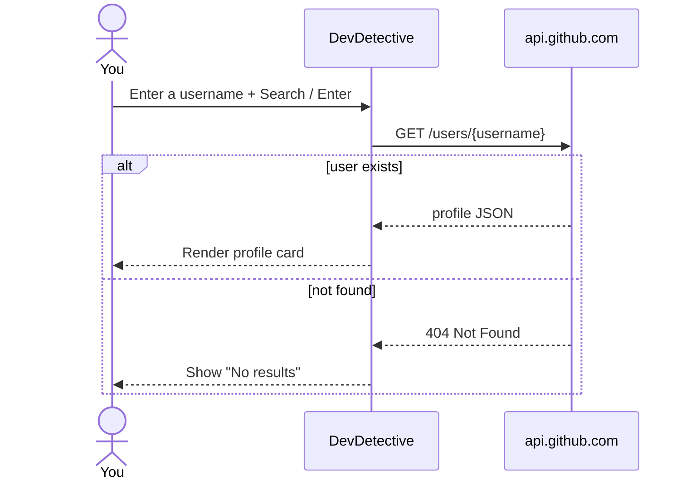

<div align="center">

# 🕵️ DevDetective

**Investigate any GitHub developer in a second — search a username and get their profile, stats and links on one clean card, in light or dark mode.**

[](https://dev-detective-neon.vercel.app)


[Features](#-features) · [How it works](#-how-it-works) · [How to Use](#-how-to-use) · [Getting Started](#-getting-started) · [Contributing](#-contributing)

</div>

---

## ✨ Features

- 🔍 **Search any GitHub user** by username
- 🪪 **Profile card** with:

  | Section | Fields |
  |---|---|
  | Identity | Avatar · name · `@username` link · join date · bio |
  | Stats | Public repos · followers · following |
  | Links | Location · website · Twitter · company |

- 🌗 **Light / dark mode** toggle, remembered across visits with `localStorage`
- 🚫 **"No results"** feedback for usernames that don't exist
- 📱 **Responsive** design for all screen sizes

## 🔄 How it works



## 🎮 How to Use

1. Enter a GitHub username in the search bar.
2. Click **Search** or press **Enter**.
3. The profile appears below the search bar.
4. Toggle **LIGHT / DARK** with the mode button in the header.

## 🚀 Getting Started

No dependencies, no build step.

```bash
git clone https://github.com/Shariq2003/DevDetective.git
cd DevDetective
# open index.html in your browser
```

> ℹ️ The unauthenticated GitHub API allows 60 requests per hour per IP.

<details>
<summary><b>📁 Project structure</b></summary>

```text
DevDetective/
├── index.html
├── styles.css
├── script.js       # API call, rendering, theme toggle
└── assets/         # icons & favicon
```

</details>

## 🤝 Contributing

Contributions are welcome!

1. Fork the repository
2. Create a branch: `git checkout -b feature/YourFeature`
3. Commit: `git commit -m "Add some feature"`
4. Push: `git push origin feature/YourFeature`
5. Open a Pull Request

---

<div align="center">

Built by **[Shariq](https://github.com/Shariq2003)** · [LinkedIn](https://www.linkedin.com/in/shariq-sd)

⭐ If you like this project, consider giving it a star!

</div>
